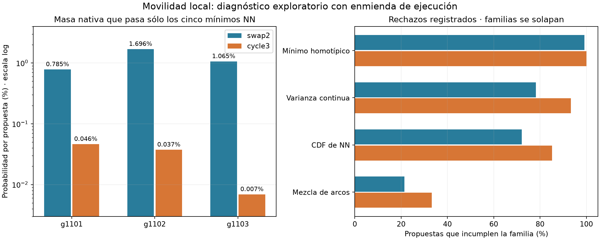

# LARP — movilidad bajo restricciones y censo de exclusión

9 de octubre de 2026. **Cerrar la secuencia de buscadores; preparar el estudio de compromisos local/espectral.** Con el operador y kernel fijados, swaps aceptó 5 de 1140 propuestas y ciclos de tres 0 de 1140. Ninguna cadena se alejó más de dos etiquetas de la nativa. No se alcanzó la puerta operativa de cinco aceptados y veinte nodos de distancia en ambas semillas de al menos dos geometrías. No se evaluaron tareas, adquisición, redes o utilidad MHU.

La colección es **AMENDED_EXPLORATORY_OPERATOR_DIAGNOSTIC**, no una ejecución confirmatoria original completa. Coste científico: 110,662366 s para calibración/preparación/doce cadenas, más 0,430626 s de censo algebraico = **111,092992 s**, dentro del presupuesto original 360 s. Desarrollo y auditoría se contabilizan aparte. No se repitió ninguna cadena ni se actualizó H1–H6/C/H-R.

## 1. Contraste realmente ejecutado

Tres sustratos históricos g1101/g1102/g1103, dos namespaces nuevos por operador, cap común 190: doce cadenas, 2280 propuestas. Se conservaron X/E, centros, conteos, radios por nodo, modos y las 130 guardas locales v2, incluida varianza continua±5%. Ambos operadores recalcularon todas las features mediante la misma ruta. La aceptación fue neutral: pasar todas las guardas locales, sin energía ni aceptación espectral.

Swaps selecciona dos tipos distintos; ciclo tres selecciona tres y una rotación±1. Comparten la regla 80% vecinos / 20% global: nodos ancla uniformes y los otros sitios entre los cuatro vecinos más próximos de su tipo, o uniformes globales. Los ciclos conservan conteos; **no se implementó un constructor que cancele deliberadamente las restricciones locales**. La comparación identifica estos operadores con sus kernels; no demuestra que todo ciclo de tres, o todo método de compensación, sea ineficaz. Tampoco es un sampler uniforme del conjunto factible.

Las probabilidades de incluir cada tipo y la cantidad de sitios alterados difieren por definición. Se registraron cambios por sitio, transporte geométrico y costes. Los tres sustratos son las unidades geométricas; propuestas y semillas no fabrican réplicas independientes.

## 2. Incidente, enmienda y procedencia

La ejecución original terminó como **BUG_INVALID / INVALID_EXPERIMENT** después de diez cadenas completas. Windows rechazó `os.replace` del archivo mutable de progreso cuando el supervisor lo leía. Falló antes de iniciar las dos cadenas g1103/seed1; no habían consumido su RNG ni generado propuestas.

Se congelaron 41 archivos de esa cápsula, se auditó el parcial como PARTIAL_ONLY y se adoptó [un suplemento prospectivo](docs/decisions/ADR_2026_10_09_MOBILITY_IO_SUPPLEMENT.md). El supervisor nuevo publica archivos inmutables con marcadores de disponibilidad después de cerrarlos, evitando reemplazar una ruta que otro proceso tiene abierta. Los tests stdlib verificaron identidad PID/PPID, fin normal y corte por tiempo.

Sólo se ejecutaron las dos identidades pendientes, con sus mismas semillas, cap, código matemático y 20 s máximos. Consumieron 18,660875 s del saldo original; no se concedió otro presupuesto 360. El fallo y la puerta que no lo anticipó permanecen documentados. La [colección combinada](artifacts/constrained_mobility/combined_results.json) acredita doce registros individuales; nunca reclasifica la cápsula fallida. I/O y lote temporal limitan los ratios por segundo: quedan descriptivos. Los endpoints por190 evaluaciones conservan el mismo mecanismo científico.

## 3. Resultados de movilidad

| Geometría / semilla | Swaps aceptados | Ciclos aceptados | Hamming final swaps / ciclos | Hamming máximo swaps / ciclos |
|---|---:|---:|---:|---:|
| g1101 /0 |1 |0 |2 /0 |2 /0 |
| g1101 /1 |0 |0 |0 /0 |0 /0 |
| g1102 /0 |1 |0 |2 /0 |2 /0 |
| g1102 /1 |1 |0 |2 /0 |2 /0 |
| g1103 /0 |1 |0 |2 /0 |2 /0 |
| g1103 /1, suplemento |1 |0 |2 /0 |2 /0 |

Admisibilidad global observada: swap2≈0,439%; cycle3=0%. La mayor **media S de un componente sobre los seis modos** al final de cualquier cadena fue≈.00706, lejos del contraste de media≥.25; no es un máximo de un modo individual. Esto es descriptivo: la fase no perseguía un target espectral ni generó controles para una comparación de utilidad. [Resumen reproducible](artifacts/constrained_mobility/analysis_v1.json).

| Familia incumplida | Swaps: propuestas /1140 | Ciclos: propuestas /1140 |
|---|---:|---:|
| Mínimo NN homotípico |1130 (99,12%) |1140 (100%) |
| Varianza continua |892 (78,25%) |1064 (93,33%) |
| CDF de NN |822 (72,11%) |971 (85,18%) |
| Mezcla dirigida de arcos |245 (21,49%) |379 (33,25%) |

Las familias se solapan. No sumar porcentajes ni interpretar sus frecuencias como efectos causales independientes. El mínimo fue el **único** bloqueo familiar en 116 swaps y 22 ciclos. Suprimirlo hipotéticamente admitiría, en esos estados observados,121/1140 y 22/1140 propuestas: incluye los cinco swaps ya aceptados. Esa aritmética no es una cadena bajo guardas relajadas ni demuestra que quitarlas permita llegar al contraste espectral. No se relajó ninguna.

## 4. Desviación informativa: contar movimientos posibles

El predominio del mínimo motivó [un censo algebraico posterior](docs/decisions/ADR_2026_10_09_NATIVE_EXCLUSION_CENSUS.md), adoptado antes de calcularlo, con máximo 20 s del saldo original. No fue un tercer optimizador: contó relaciones entre índices, sin generar o evaluar etiquetas candidatas completas.

Para cada tipo c, un grafo prohíbe pares que violan el déficit mínimo nativo. La arista dirigida D_ij permite trasladar la marca de i a j tras retirar i, sin introducir un par prohibido de ese tipo. Un swap pasa la familia iff D_ijD_ji; un ciclo de tres iff D_ijD_jkD_ki. Los conteos son `sum(D·Dᵀ)/2` y `tr(D³)/3`, en int64. Los cinco mínimos constituyen **cinco** desigualdades; quedan 125 fuera del censo. [Precisión de alcance](artifacts/constrained_mobility/census_scope_erratum.md).

| Nativa | Swaps que pasan sólo los mínimos | Ciclos orientados que pasan sólo los mínimos | Masa nativa swap2 | Masa nativa cycle3 |
|---|---:|---:|---:|---:|
| g1101 |24 |13 |0,784914% |0,046338% |
| g1102 |53 |10 |1,695868% |0,037432% |
| g1103 |34 |2 |1,064958% |0,006909% |

Hay ciclos de tres que pasan esta familia. Por tanto, **no hay aislamiento de la nativa bajo la sola guarda mínima para ese operador**. Eso no prueba que algún ciclo pase las otras 125 desigualdades, ni conectividad o movilidad sostenida bajo el conjunto completo.

Las masas corresponden exactamente al kernel congelado, condicional a la nativa y a sólo esta familia; acotan por arriba la admisibilidad completa. La masa de ciclos es entre 17 y154 veces menor que la de swaps en las respectivas referencias. Bajo evaluación repetida de la nativa, 380 propuestas por geometría sumarían sólo ≈0,345 propuestas esperadas que superaran los mínimos para ciclos. No hace falta postular imposibilidad para explicar cero aceptados. Esta es una propiedad del muestreador, no un likelihood de MHU ni una actualización bayesiana sobre utilidad.

El censo no valida una hipótesis empírica con datos nuevos: es una deducción verificada sobre las mismas geometrías. Verifica que estas nativas contienen una selección extremadamente estrecha de movimientos pequeños y que un ciclo aleatorio no garantiza compensación local. [Resultados y código](artifacts/constrained_mobility/native_exclusion_census_v1.json).

**Limitación del diseño propio:** estas masas debieron calcularse antes del diagnóstico aleatorio. Su valor muestra que 190 propuestas por cadena tenían escasa capacidad de encontrar admisibilidad para B. El fallo de su puerta de ingeniería es real, pero no discrimina bien la hipótesis general de compensación mediante tres sitios. Antes de otra construcción, la siguiente verificación estructural útil sería comprobar las125 guardas restantes en los pocos movimientos que pasan los mínimos, con protocolo y presupuesto propios; todavía no se hizo. Esto evita convertir una búsqueda mal apoyada en un veredicto sobre el operador abstracto.

## 5. Auditoría y antecedentes

La [suite completa](artifacts/constrained_mobility/tests_io_v2/junit.xml) pasó 286 pruebas; tras la última precisión del deadline, los [dos tests IPC](artifacts/constrained_mobility/tests_io_final/junit.xml) volvieron a pasar. La [auditoría de colección](artifacts/constrained_mobility/independent_combined_trace_audit_v1.json) reprodujo semillas, movimientos, hashes, conservación y decisiones de 2280 filas, con 296.400 desigualdades registradas. Recalculó por fórmulas propias 41 candidatos prefijados y 24 estados nativos/finales: todos los booleanos coincidieron. El recálculo independiente no cubre cada valor de cada propuesta; sí el replay y las comprobaciones internas de todas las filas. La auditoría original permanece separada del suplemento.

El [censo independiente](artifacts/constrained_mobility/independent_native_exclusion_census_v1.json) verifica construcción escalar del grafo, conteo por bitsets y una suma de masa sobre movimientos válidos con fracciones exactas frente a la enumeración de draws del cálculo principal. Comparten el helper de distancias ya auditado y sus bytes coinciden con el cache congelado LARP; no es otra implementación de toda la geometría ni una réplica de laboratorio. El diferencial máximo de probabilidades fue 2,78×10⁻¹⁷. Los 561 archivos científicos/de gobernanza previos permanecen intactos.

La reconfiguración por swaps y cambios de Kempe tiene antecedentes cercanos: [Feghali et al., EJC 2017](https://www.sciencedirect.com/science/article/pii/S0195669816300488) y [Fuchs et al., ISAAC 2025](https://drops.dagstuhl.de/entities/document/10.4230/LIPIcs.ISAAC.2025.33), publicaciones revisadas por pares. El arXiv del segundo es una versión del mismo trabajo. Sus garantías o complejidad no se transfieren a nuestros cinco grafos dependientes del tipo y 130 guardas. [Nota de estructura y límites](docs/projects/LOCAL_EXCLUSION_RECONFIGURATION_NOTE.md). No se reclama originalidad de movimientos restringidos, conteos de ciclos o teoría de reconfiguración.

## 6. Decisión AB y siguiente fase

- **belief_revision:** ninguno de los dos operadores+kernel alcanzó viabilidad dentro del plan. Eso es evidencia sobre esta estrategia y coste, no sobre utilidad neuronal MHU. No atribuir la falta de movilidad sólo al recocido: persistió con aceptación neutral. La hipótesis general de movimientos compensados mayores permanece abierta.
- **hypothesis_generation:** representar la exclusión como grafos sugiere estudiar soporte y cotas estructurales; el resultado no autoriza un tercer buscador por inercia ni confirma que quitar mínimos resuelva el matching.
- **objective_revision:** distinguir utilidad total de organización y efecto residual condicionado. Ausencia de efecto residual no identifica por sí sola mediación local.
- **decision:** cerrar esta intervención. Mantener q=.25 sin identificar y los priors arquitectónicos intactos. Preparar [el estudio de compromisos local/espectral](docs/projects/LOCAL_SPECTRAL_TRADEOFF_NEXT_DRAFT.md), sin ejecutarlo aquí. Propone rival local fuerte, puntos alcanzados y posterior adquisición con decoders fuertes y nuevas geometrías. No llamarlo frontera Pareto verdadera ni comparación causal perfectamente emparejada.

**Innovación: 1/3.** Hay información nueva y útil para LARP, sobre todo el censo barato que distingue rareza de ausencia. Las herramientas matemáticas y el problema de reconfiguración son conocidos; tres referencias y una familia necesaria no constituyen todavía una contribución general ni un hallazgo neuronal. La reparación de infraestructura no aumenta esa puntuación.
