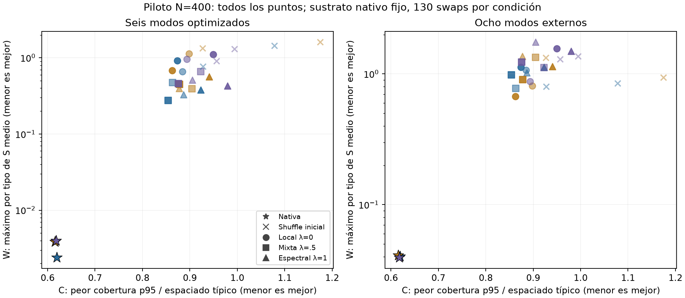

# LARP — Vecindario nativo completo y piloto local/espectral

2026-10-09. Dos fases autorizadas, terminadas y auditadas. Padre científico: `4f2f9a1`. Protocolos: [vecindario](docs/decisions/ADR_2026_10_09_FULL_NATIVE_NEIGHBORHOOD.md) y [piloto](docs/decisions/ADR_2026_10_09_LOCAL_SPECTRAL_TRADEOFF.md). Datos completos: [análisis guardado](artifacts/next_exploration/analysis_v1.json).

**Resultado:** el vecindario nativo sí admite ciclos colectivos bajo las 130 guardas. El fracaso anterior de cycle3 no prueba aislamiento: su kernel casi nunca propone los movimientos válidos. En cambio, el nuevo constructor de 130 swaps desde shuffle no produce estructuras competitivas con la referencia nativa; se cierra conforme a su puerta. Ninguna fase prueba utilidad neuronal de MHU.

## 1. Auditoría exhaustiva, sin búsqueda

Cada candidato parte directamente de nativa. X, E, radios físicos por nodo, centros, conteos y las 130 tolerancias se conservaron. El filtro MIN se enumeró por completo; después se verificó el resto. No se evalúa sólo una muestra de candidatos.

| Sustrato | Swaps que pasan MIN | Swaps que pasan las 130 | Ciclos orientados que pasan MIN | Ciclos que pasan las 130 | Masa completa swap2 | Masa completa cycle3 |
|---|---:|---:|---:|---:|---:|---:|
| g1101 | 24 | 16 | 13 | 11 | 0.0047872363 | 0.0004317440 |
| g1102 | 53 | 37 | 10 | 5 | 0.0106079631 | 0.0001587735 |
| g1103 | 34 | 24 | 2 | 2 | 0.0072597758 | 0.0000690856 |

De 136 candidatos necesarios, **95 pasan todo: 77 swaps y 18 ciclos**. Las masas son las del kernel histórico, condicionado sólo al estado nativo, con mezcla 80% near/20% global. Sus fracciones exactas figuran en [results.json](artifacts/native_neighborhood/v1/results.json); no son likelihoods de hipótesis MHU.

Las seis cadenas históricas cycle3 realizaron 380 propuestas por sustrato y permanecieron en nativa. Bajo el modelo explícito de propuestas independientes, las aceptaciones esperadas son 0.1641, 0.0603 y 0.0263. La probabilidad calculada de cero en las seis cadenas es aproximadamente **0.7783**. El cálculo usa las masas auditadas y `(1−p_g)^380`; explica la rareza del evento, no constituye Bayes factor, prueba de mixing ni confirmación independiente. El contraste anterior tenía muy poca capacidad de detectar estos ciclos.

Todos los vecinos completos conservan los umbrales espectrales finitos de medias≤.05 y modos≤.1. El mayor W alcanzado entre vecinos completos es .0107563/.00636785/.00705848. No aparece un control con todas las medias≥.25. Permitir un movimiento no garantiza desplazamiento acumulado, componente factible grande ni acceso al objetivo espectral.

[Auditoría por fórmulas alternativas](artifacts/native_neighborhood/alternative_audit_v1.json): PASS en los **136 candidatos y 17.680 desigualdades**, enumerador alternativo, espectros, conteos, hashes y masas exactas. Las cinco primeras aceptaciones históricas de swaps coinciden con vecinos completos. Es verificación con código alternativo ejecutado por el mismo agente, no réplica externa.

## 2. Deducción estructural posterior, explícitamente post hoc

Se examinó la factorización de los 18 ciclos completos utilizando exclusivamente listas ya guardadas, sin evaluar nuevos estados. Quince endpoints pueden alcanzarse mediante dos swaps admisibles. Tres de g1101 no tienen ninguna descomposición admisible de dos swaps desde nativa:

- `76→166→97→76`;
- `151→307→297→151`;
- `155→225→235→155`.

Para factorizar un ciclo de tres posiciones en dos transposiciones, el primer swap tiene que ser uno de los tres pares de esas posiciones. Los tres pares fallan el gate completo en esos casos. Es una conclusión algebraica sobre este vecindario. **No excluye caminos más largos con otros nodos**, no establece desconexión global ni que cycle3 sea indispensable. Motiva una hipótesis nueva sobre movilidad colectiva que requiere otro protocolo para estudiar desplazamiento sostenido. Los detalles y las descomposiciones positivas están en `analysis_v1.json`.

## 3. Piloto de construcción y estimando distinto

Sobre los mismos tres X, dos shuffle nuevos por X y prioridades λ=0,.5,1, se realizaron 18 cadenas. C es el peor p95 de cobertura normalizado por `a_c`; W, el máximo por tipo de la media de S en seis modos. Se optimizó `J=(1−λ)C+λW`; `Q=W/.05` se mantuvo como diagnóstico. La corrección de escala quedó registrada antes de ejecución.

El kernel común intercambia marcas entre un par uniforme de tipos y nodos uniformes. Cada triple de prioridades comparte shuffle inicial y streams de propuestas/aceptación. Temperatura .02→.0002, mejor J visitado, empate conserva primera aparición. Sólo conteos son invariantes duros en esta exploración. Las guardas históricas se diagnostican al final, sin modificarlas. λ0 es el rival local con esfuerzo igual, **no un constructor local óptimo garantizado**.

La calibración desechó 60 evaluaciones, peor coste .0152868s, y fijó prospectivamente **P=130** con la regla registrada. Hubo **2.340 propuestas**, sin reinicios ni extensión. Ocho modos externos no participaron en selección. Todas las trayectorias y etiquetas finales se conservaron.

| Sustrato | Seed | λ | C | W (6 modos) | W externo (8 modos) |
|---|---:|---:|---:|---:|---:|
| g1101 | 0 | 0 | .873757 | .914261 | 1.128846 |
| g1101 | 0 | .5 | .854030 | .276839 | .984117 |
| g1101 | 0 | 1 | .923034 | .380608 | 1.126894 |
| g1101 | 1 | 0 | .884543 | .663014 | 1.071322 |
| g1101 | 1 | .5 | .863620 | .476330 | .776049 |
| g1101 | 1 | 1 | .886535 | .328659 | 1.024121 |
| g1102 | 0 | 0 | .862509 | .681891 | .674738 |
| g1102 | 0 | .5 | .877865 | .450116 | .902856 |
| g1102 | 0 | 1 | .940315 | .563599 | 1.141563 |
| g1102 | 1 | 0 | .897919 | 1.138040 | .809594 |
| g1102 | 1 | .5 | .904657 | .393473 | 1.339896 |
| g1102 | 1 | 1 | .877073 | .395435 | 1.365230 |
| g1103 | 0 | 0 | .949543 | 1.111000 | 1.560395 |
| g1103 | 0 | .5 | .875554 | .457205 | 1.235305 |
| g1103 | 0 | 1 | .979708 | .428028 | 1.495852 |
| g1103 | 1 | 0 | .893739 | .961446 | .876257 |
| g1103 | 1 | .5 | .922588 | .656267 | 1.120208 |
| g1103 | 1 | 1 | .905044 | .513128 | 1.752469 |

Referencias nativas `(C,W,W_externo)`:

- g1101: `(.619412,.002392,.040195)`;
- g1102: `(.615411,.003871,.040824)`;
- g1103: `(.617787,.003982,.039362)`.



La nativa domina estrictamente los 18 puntos en C y W y también tiene menor W externo. Las salidas incumplen **110–120 de las 130 restricciones históricas**; no son controles residuales aproximados. La puerta prospectiva falla: ninguna salida evita la dominancia nativa, además de los compromisos externos y la falta de réplica requerida. **Cerrar este constructor breve sobre shuffle; no añadir corridas o optimizadores para rescatarlo.**

El resultado no es una comparación justa de generadores. La nativa procede de coadaptar posiciones y marcas mediante otro algoritmo y esfuerzo. Su manifest g1101 registra 6.000 pasos Adam, 1.000 iteraciones L-BFGS-B y aproximadamente 8s de optimización; aquí se congela precisamente ese X y se permiten 130 swaps desde shuffle. Nativa es referencia estructural existente, no tratamiento a cómputo igual. Tampoco probamos que cobertura y supresión espectral sean intrínsecamente incompatibles, ni que λ=.5 represente un compromiso universal. Sólo describimos los puntos alcanzados por esta familia y presupuesto.

Reducir los seis modos seleccionados no garantiza transferencia a la banda externa. Sus valores permanecen altos y algunas condiciones empeoran esa banda. Ambas bandas son finitas: no acreditan el límite k→0. No hubo adquisición, scores de tareas, redes ni inferencia de ventaja causal MHU.

[Replay alternativo](artifacts/local_tradeoff/alternative_audit_v1.json): PASS de las 2.340 propuestas, cada decisión de aceptación, amplitudes por sumas directas, estados mejores, nueve objetivos baseline, espectros externos/cruzados y **2.340 restricciones finales** de las 18 construcciones. No se presenta el replay como nueva evidencia empírica. Otro agente revisó protocolo y cierre; esa revisión tampoco es réplica externa.

## 4. Coste, ingeniería y trazabilidad

PC: i9-12900KF, 16 núcleos/24 hilos, ~31.82GiB RAM, RTX4070SUPER con12GB. Estas fases usaron NumPy/SciPy float64 y cuatro threads CPU; no se cambió el entorno histórico ni se instaló CUDA. Son patrones pequeños; la aceleración debe medirse cuando haya carga que la justifique.

- Vecindario: **10.9387333s científicos**, límite60s; auditoría alternativa27.4187678s adicionales.
- Piloto: **45.3873272s científicos**, límite180s; auditoría alternativa43.0472698s adicionales.
- Total de ambas ejecuciones científicas: **56.3260605s**. Validación computacional se declara aparte; tampoco se ocultan preparación de código, revisión o tests dentro de esa cifra.
- Suite actual: **294 PASS en15.69s**, [Junit](artifacts/next_exploration/tests_final/junit.xml). Los primeros tests sintéticos detectaron codificación incorrecta en un worker temporal de prueba; corregido antes de toda corrida científica, resultado de fallo conservado. No fue evidencia contra MHU.
- Supervisores de un solo intento, PID real, deadline absoluto entero, archivos exclusivos más marcador ready tras cierre. Antes del piloto, la revisión corrigió verificación del tiempo de phase_end usando supervisor v2 separado; el v1 nativo permanece intacto. Cierre verifica los tiempos de fases completadas.

Sellos: [nativo](artifacts/native_neighborhood/v1/prelaunch_seal.json) y [piloto](artifacts/local_tradeoff/v1/prelaunch_seal.json). Preservan fuentes/configs/sustratos y el historial científico previo. El sello del piloto incluye además los artefactos nativos terminados. No reejecutar estas carpetas: las rutas existentes rechazan sobreescritura. Los auditores permiten verificar resultados guardados con una ruta NUEVA de salida, sin repetir investigación:

```powershell
.\.venv\Scripts\python.exe -B artifacts/native_neighborhood/audit.py --output <archivo_nuevo.json>
.\.venv\Scripts\python.exe -B artifacts/local_tradeoff/audit.py --output <otro_archivo_nuevo.json>
```

## 5. AB y siguiente decisión

**belief_revision:** queda descartada la afirmación de aislamiento nativo completo para cycle3 bajo estas guardas. Su ausencia de aceptaciones históricas es compatible con rareza del kernel. Este constructor breve no produjo puntos competitivos. No hay actualización numérica de H1–H6, C o roles.

**hypothesis_generation:** tres endpoints colectivos carecen de ruta admisible de dos swaps; puede haber rutas largas. Nuevo test: condicionar el kernel original a pasar MIN conservando sus masas relativas puede revelar movilidad sostenida que el muestreador anterior no resolvía. Su mayor aceptación sería esperable por construcción; el endpoint informativo es desplazamiento/estados distintos por tiempo, no porcentaje de aceptaciones.

**objective_revision:** ninguna de misión. El piloto total sigue separado del control residual v2 cerrado y no lo rescata. La secuencia breve de swaps desde shuffle termina aquí.

**decision:** proponer un último diagnóstico acotado del componente factible, [plan sin ejecutar](docs/projects/MIN_CONDITIONED_MOBILITY_NEXT.md). Si sólo oscila entre pocos estados, cerrar búsqueda sobre estos X y pasar a diseño conjunto de geometría/marcas con rival local fuerte y esfuerzo comparable. No ampliar aún a3D, multicapa ni entrenamiento neuronal: aumentar hardware no resuelve identificación causal.

Para escalar generación en un protocolo posterior hay antecedente directo: [Shih/Casiulis/Martiniani, PRE2024](https://journals.aps.org/pre/abstract/10.1103/PhysRevE.110.034122), revisado, usa NUFFT y O(N log N), con ejemplos2D/3D y restricciones reales. Es una opción para estudiar/adaptar, no un resultado nuevo nuestro. El rival multiclase tiene antecedente en [Wei, SIGGRAPH2010](https://www.liyiwei.org/papers/noise-sig10/); no equiparar blue noise y HU asintótica. Las fuentes y sus límites están registrados en el ADR del piloto.

**Innovación honesta:1/3.** Valor diagnóstico y una deducción estructural delimitada; sin demostrar mecanismo útil, algoritmo original o resultado publicable por sí solo.
