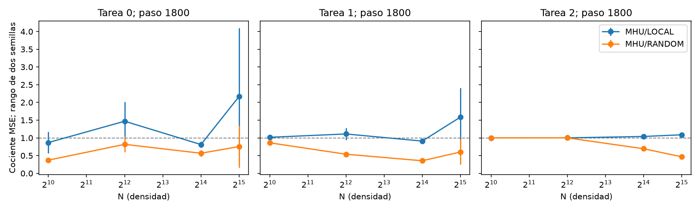

# LARP — Resultado descriptivo de escala 3D v2

Estado del job: `COMPLETE`.

Las ocho tríadas comparten el checkpoint **1800**. La tabla permite comparar tamaños en ese endpoint común.

| N | Tarea | Paso | MSE MHU | MSE LOCAL | MSE RANDOM | MHU/LOCAL | MHU/RANDOM |
|---:|---:|---:|---:|---:|---:|---:|---:|
| 1024 | 0 | 1800 | 0.111238 | 0.141024 | 0.307722 | 0.868208 | 0.371168 |
| 1024 | 1 | 1800 | 0.556071 | 0.54743 | 0.646422 | 1.01601 | 0.860565 |
| 1024 | 2 | 1800 | 1.00839 | 1.00851 | 1.00861 | 0.999883 | 0.999789 |
| 4096 | 0 | 1800 | 0.0766173 | 0.0547685 | 0.0941945 | 1.46949 | 0.817666 |
| 4096 | 1 | 1800 | 0.147812 | 0.134466 | 0.274833 | 1.11004 | 0.538961 |
| 4096 | 2 | 1800 | 1.00842 | 1.00817 | 1.00803 | 1.00025 | 1.00039 |
| 16384 | 0 | 1800 | 0.0376458 | 0.0465088 | 0.067419 | 0.811694 | 0.566052 |
| 16384 | 1 | 1800 | 0.0384369 | 0.0423335 | 0.108651 | 0.909171 | 0.353984 |
| 16384 | 2 | 1800 | 0.510446 | 0.491302 | 0.736578 | 1.03891 | 0.692971 |
| 32768 | 0 | 1800 | 0.060835 | 0.0461425 | 0.0865 | 2.16673 | 0.754301 |
| 32768 | 1 | 1800 | 0.0489657 | 0.0300976 | 0.0844689 | 1.5853 | 0.601525 |
| 32768 | 2 | 1800 | 0.23935 | 0.220206 | 0.513564 | 1.08683 | 0.466111 |

MSE: media de dos semillas geométricas. Cocientes: media de dos cocientes emparejados; un denominador cero deja el cociente sin definir. CSV contiene mínimos y máximos entre semillas, sin intervalos inferenciales.

En el paso 300 sólo se ha entrenado la tarea 0; hasta el paso 600 la tarea 2 aún no entra en el currículo. Sus evaluaciones tempranas no miden competencia después de entrenarla.

Se escala densidad en un toro fijo con parámetros, grado y profundidad constantes; el alcance físico cambia. Geometría y conexiones cambian juntas. El certificado MHU es finito, LOCAL puede también suprimir potencia espectral, y dos semillas no constituyen confirmación concluyente. No se declara superioridad general ni equivalencia con retina desordenada. CIC puede inducir orden de rejilla; su medida debe inspeccionarse por brazo. Tampoco se actualizan los priors históricos H1–H6/C.
